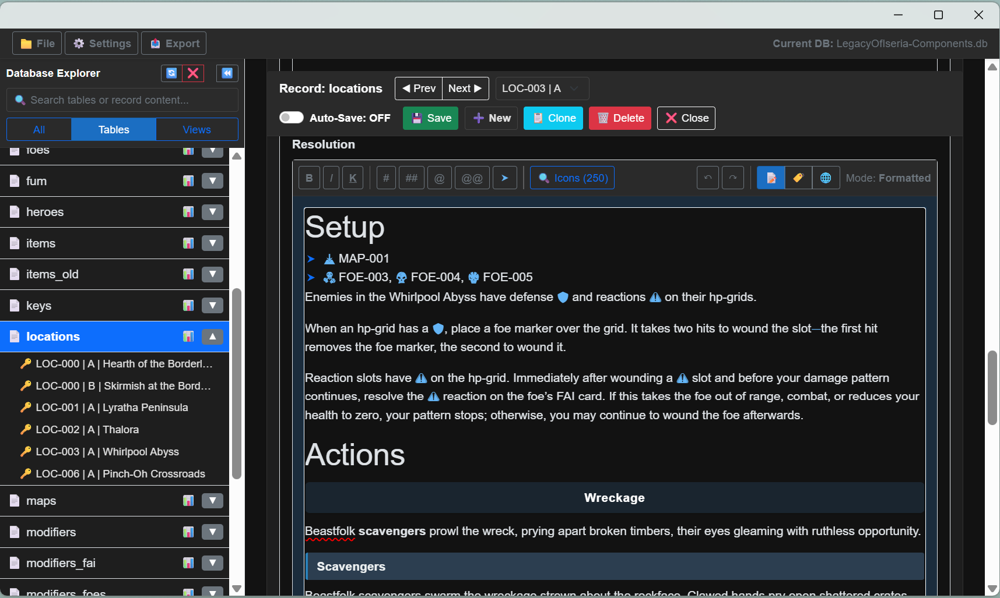
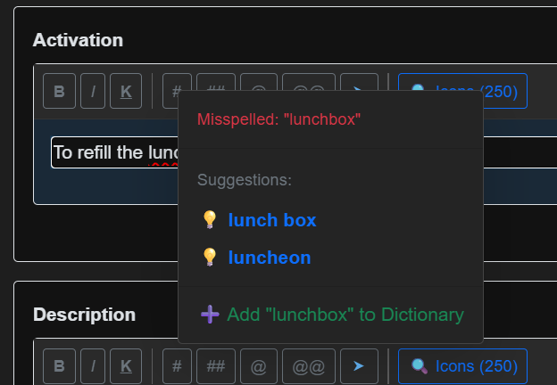
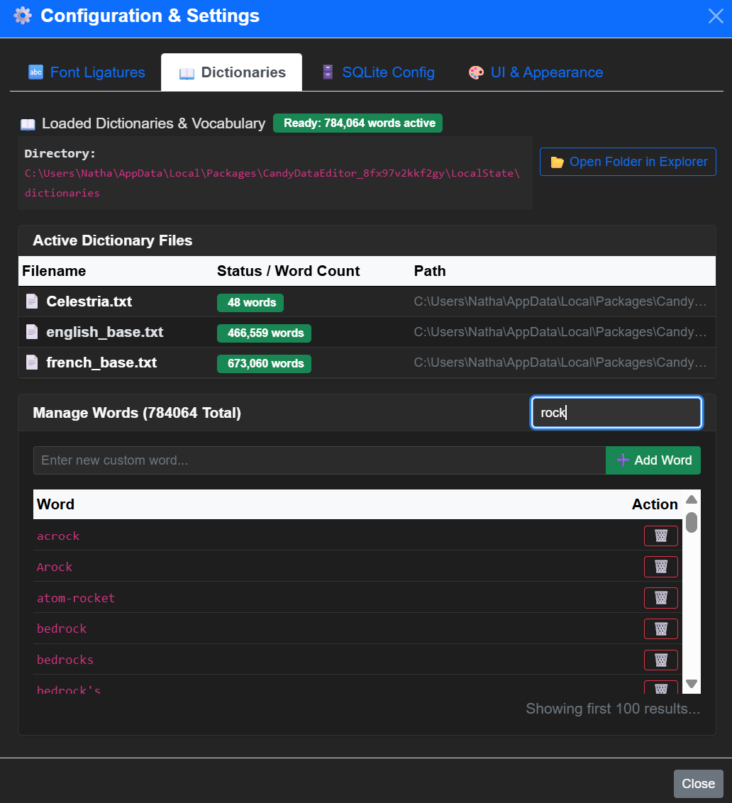
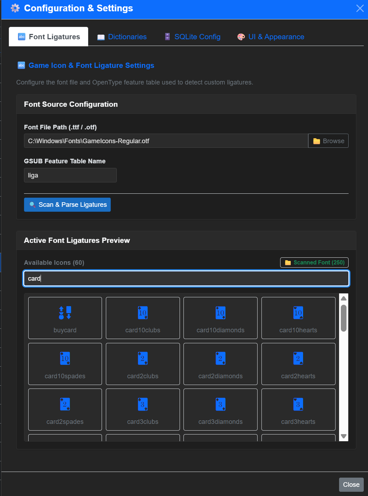
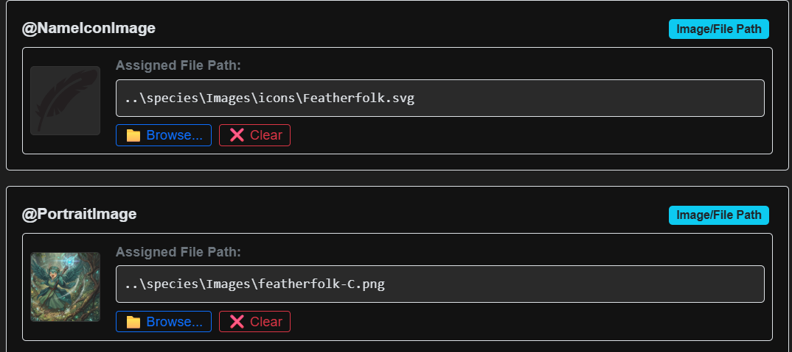
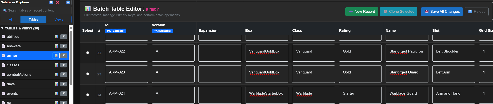
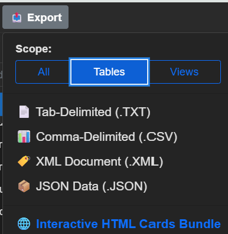

# 🍬 CandyDataEditor

**CandyDataEditor** is a desktop-grade SQLite database management application built with **C# .NET Blazor** and **Bootstrap 5**.
Designed specifically for game development workflows, it pairs relational data navigation with dynamic rich-text editing—featuring font icon previewing and spellcheck dictionaries.


---

## 🚀 Features

* **Database Dashboard**: Track active database path status, view recent database file history with persistent limit management, and monitor spellcheck dictionary health.
* **Interactive Data Sidebar**: Deep inspection of SQLite tables and views with real-time filtering, primary key mapping, and accordion record navigation.
* **Rich Text & Spellcheck Editor**: Custom TipTap JS integration providing inline game-icon font ligatures (e.g., `[place]`, `[defense]`) and spellcheck validation.
* **Multi-Format Export Engine**: Multi-table data export support for TSV, CSV, XML, JSON, and standalone Interactive HTML Cards.
* **UI Light/Dark Mode Support**: Seamless switching between light and dark themes for improved usability in different lighting conditions.
* **Custom Dictionary Management**: Add, remove, and manage custom wordlists for spellcheck directly within the application.
* **Custom File Reference Saving**: Configure your file reference saving behavior to either store absolute paths or relative paths based on your project needs.
---

## 🛠️ Project Structure

```text
CandyDataEditor.sln
│
├── CandyDataEditor/               # Main C# Blazor Project
│   ├── Components/
│   │   ├── Fields/                # Custom Blazor form fields (e.g., TipTapEditor, ImageFileFieldEditor)
│   │   ├── Fonts/                 # Ligature, Game Icon, and Font Preview and Picker components
│   │   ├── Layout/                # Layout components (e.g., MainLayout, Sidebar)
│   │   ├── Menus/                 # Menu components (e.g., RibbonMenu, ContextMenu)
│   │   ├── MessageBoxes/          # Message box components (e.g., MessageBoxes, Alerts, Notifications )
│   │   ├── Pages/                 # Page components (e.g., TableGridEditorPage, EditorPage, WelcomePage)
│   │   ├── Settings/              # Settings page components (e.g., DictionarySettingsPage, LigatureSettings, AppearanceSettings)
│   │   ├── Spellcheck/            # Spellcheck components (e.g., SpellcheckEditor, SpellcheckDictionaryManager)
│   │   ├── _imports.razor         # global component imports
│   │   ├── Routes.razor           # routing definitions
│   ├── Services/                  # Application services (e.g., SqliteData, GameDictionary, Search, Font, FileDialogs)
│   └── wwwroot/
│       └── css/                   # CSS files (e.g., bootstrap.min, site, light/dark mode styles)
│       └── dictionaries/          # Spellcheck dictionary files (e.g., custom_user_words.txt, default_game_words.txt)
│       └── js/                    # TipTap JS bundle output directory (e.g., tiptap-interop, bundle, spellcheck)
│
└── TipTap/                        # Standalone JS Bundle Project
    ├── package.json               # TipTap & esbuild dependency manifest
    ├── tiptap-entry.js            # Node source entry file
    └── node_modules/              # Managed via npm

```

---

## ⚙️ Getting Started

### Prerequisites

* **.NET 8.0 SDK**
* **Node.js** (v18+) & **npm** (installed globally for `esbuild` bundling)
* **Visual Studio 2022**
* **https://github.com/LayoutFarm/Typography** (used for ligature scanning)

### Setup & Run

1. **Clone the Repository**
```bash
git clone https://github.com/YourOrg/CandyDataEditor.git
cd CandyDataEditor

```


2. **Open in Visual Studio**
* Open `CandyDataEditor.sln`.
* Set **`CandyDataEditor`** as the Startup Project (*Right-click project -> Set as Startup Project*).


3. **Build & Launch**
* Press **`F5`** or **`Ctrl + F5`**.
* The MSBuild system automatically runs `npm install` inside `/TipTap` on first build, bundles `tiptap-entry.js` via `esbuild`, and writes the compiled output to `wwwroot/js/tiptap.bundle.js`.


## 📖 Custom Dictionaries

Spellcheck dictionaries reside in the application's bundled dictionaries directory. You can manage wordlists directly within the app:

1. Open **File** -> **Settings** -> **Dictionaries**.
2. Add or remove custom terms (saved to `custom_user_words.txt`).
3. Click **Open Folder in Explorer** to add external `.txt` vocabulary files directly.

### Dictionary Context Menu


### Dictionary Settings



## 🔤 Game Icon Font Ligatures

Supports custom ligatures from fonts where the font can be loaded into the app, scanned, and either used by simply typing, or selecting the glyph from a menu.
I have a custom ligature tool at [https://github.com/mistralCeleste/LigatureIconGenerator](https://github.com/mistralCeleste/LigatureIconGenerator).

### Ligature Settings



## 🖼️ Images in the Database Editor

To enable the image picker, preview, and file path formatting, ensure that the table contains a Text field that starts with `@`, like `@BackgroundImage`, for example. This will enable the browse button and image preview. Supported formats include PNG, JPEG, SVG. Other formats may not have a preview, like PSD, AI, and PDF.

### Image File Field Editor



## Other Samples

### Batch Editor
Edit multiple records in a table at once with a batch editor. This allows you to clone and make changes to several rows and commit them in one operation.



### Data Export
Export data from multiple tables to TSV, CSV, XML, JSON, or Interactive HTML Cards. The export engine supports multiple tables and can generate a single HTML file with embedded CSS and JS for interactive card viewing.



